

<a href="https://muhammadziadportfolio.base44.app"></a>


  


<a href="https://github.com/Ziadk7474/Spenders"></a>

  


<a href="https://github.com/Ziadk7474/KhataFlow"></a>
<a href="https://github.com/Ziadk7474/Hisably"></a>

<a href="https://github.com/Ziadk7474/Staffpay"></a>
<a href="https://github.com/Ziadk7474/Vault"></a>

<a href="https://github.com/Ziadk7474/Alfarasha"></a>
<a href="https://github.com/Ziadk7474/Spend"></a>

<a href="https://almadhicarpentry.com"></a>

  


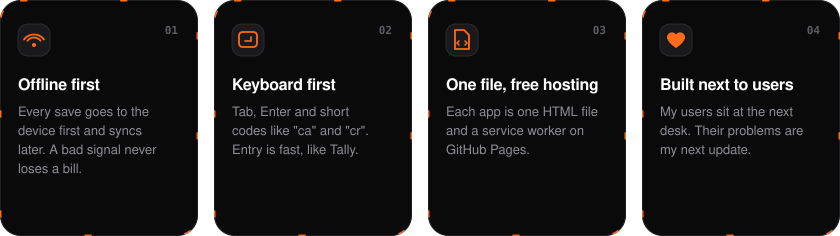


  



  



  


